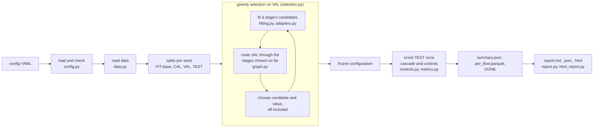

# Architecture

## What happens during a run

`runner.py` drives one run unit (a seed, or a seed and a held-out family) through these steps and
skips units whose `DONE` fingerprints still match. Stages are fitted lazily: a stage is fitted when
selection first needs its VAL scores, so a stage that uses another stage's score is fitted after that
source is chosen.

## The parts a user replaces

| Part | What it is | Replaced through |
|---|---|---|
| Model adapter | fits a model and returns scores in a standard form | any scikit-learn style class, an `idslab_contract` class, an external score file |
| Stage | model, training rows, decision rule, role | the `stages` block |
| Routing graph | where each stage output goes | `routes` and `next` |
| Selection | how candidates and values are chosen | `select_by`, `protocol.objective`, `protocol.search` |
| Evaluation | data, mode and controls | `dataset`, `protocol.mode`, `controls` |

A model is not a stage: the same random forest can be an entry check, a router or a specialist.

## Modules

| Module | Responsibility |
|---|---|
| `config.py` | YAML loading (YAML 1.2 booleans), every check of keys, values, routes and score dependencies, the selection order, the config fingerprint |
| `data.py` | reading Parquet or CSV, labels and types, stratified splits with rare-stratum merging, subsamples, file fingerprints |
| `prep.py` | `Encode`, the categorical encoder for stage pipelines |
| `adapters.py` | building estimators and pipelines; reading outputs as AttackScore, ClassProba, AnomalyScore and BatchAnomaly; `PoolDetector` |
| `features.py` | the store of out-of-fold and fitted scores used as extra features |
| `fitting.py` | training rows per stage (`train_on`, `hard`, `fit_on`), search, calibration, out-of-fold refits, external candidates |
| `external.py` | split export, the score file contract and its checks |
| `graph.py` | routing flows through the stages to a verdict and a recorded type |
| `selection.py` | greedy forward selection and the joint check |
| `controls.py` | the TEST systems (cascade, B1, B2, budget matched), stage removal, prefix steps, unseen-attack and type blocks |
| `metrics.py` | binary and type metrics, ROC hull and frontier gap, paired bootstrap, EM prevalence estimate |
| `runner.py` | run units, resume by fingerprint, parallel units, `summary.json` and the flow files, progress logging |
| `report.py`, `html_report.py` | aggregation over units, `report.md`, `report.json`, `report.html` |
| `torch_models.py` | PyTorch models with the scikit-learn interface |
| `synthetic.py` | the example dataset |
| `cli.py` | the `idslab` command |
| `dashboard/` | the web UI ([source reference](../src/idslab/dashboard/README.md)) |

## Extending

- **A new model**: if it has the scikit-learn interface, name it in `candidates`; otherwise write an
  adapter class ([Models in stages](models.md#your-own-adapter-class)).
- **A new preprocessing step**: any class with `fit` and `transform` (or `fit_resample`) works as a
  pipeline step.
- **A new objective or control**: objectives live in `metrics.py` and `config.OBJECTIVES`; controls
  are computed in `controls.evaluate` and aggregated in `report.aggregate`. A change that can alter
  results bumps the version, so finished units are not reused by mistake.

The reasoning behind each protocol rule is in [DESIGN.md](../DESIGN.md).
