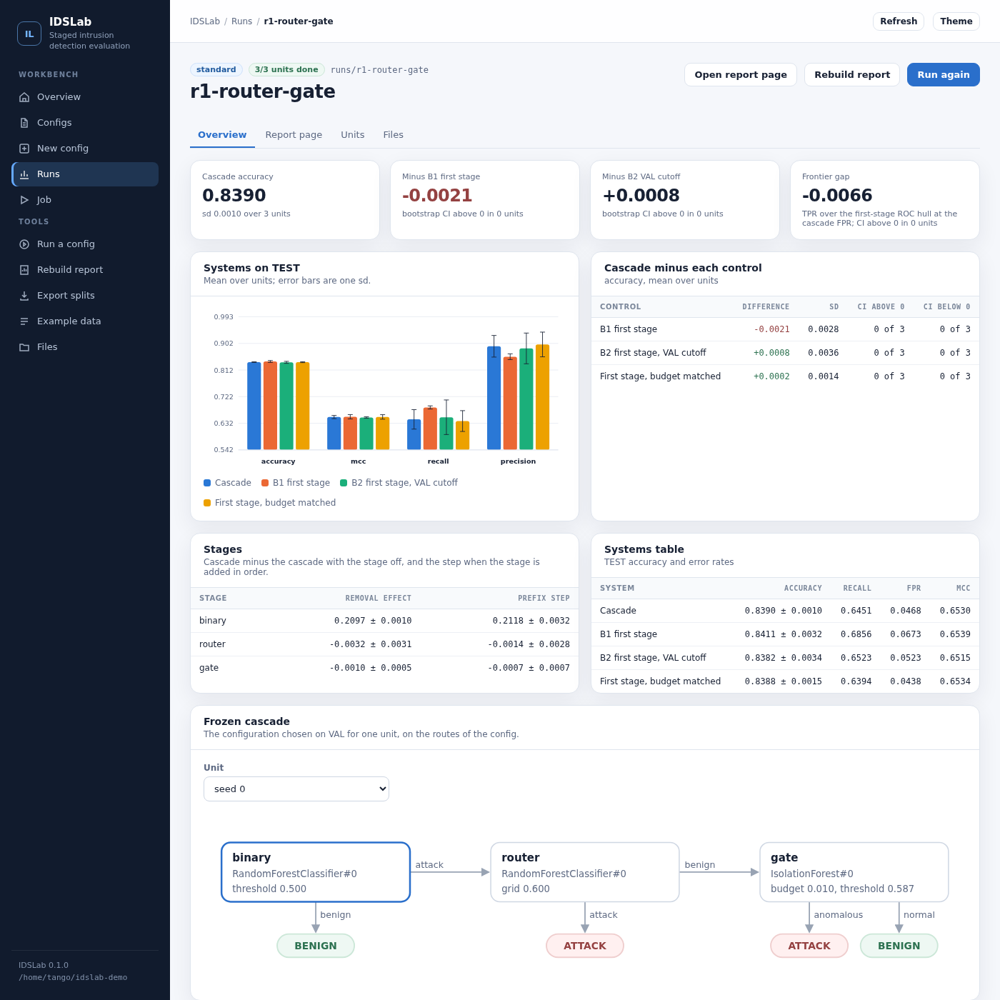
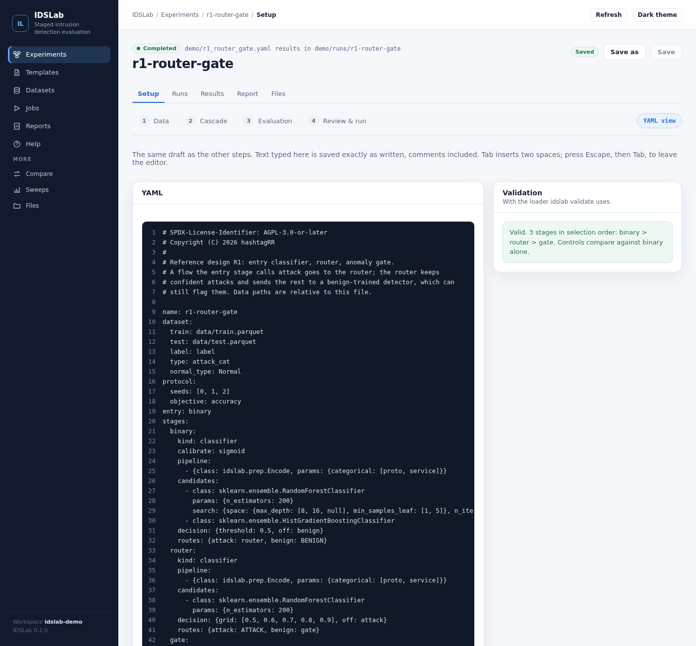
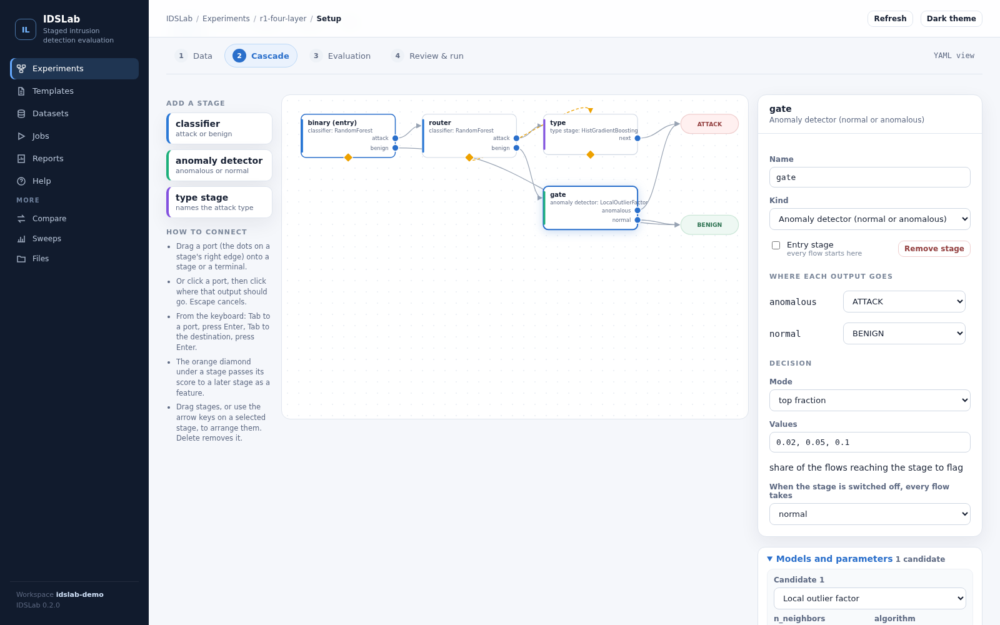

# Dashboard

```bash
idslab dashboard --workspace demo --open
```

| Option        | Default     | Meaning                                                            |
|---------------|-------------|--------------------------------------------------------------------|
| `--workspace` | `.`         | the folder the dashboard works in: configs, data and run outputs    |
| `--host`      | `127.0.0.1` | address to listen on                                               |
| `--port`      | `8765`      | port; `0` picks a free one                                         |
| `--open`      |             | open the page in the default browser                               |



On Windows, see [Windows, step by step](../INSTALL.md#windows) for installing, starting
and stopping the dashboard.

The page works without a network connection and stores nothing outside the workspace (the theme
choice and the last output folder per command are kept in the browser).

## Pages

| Page            | What it does                                                                 |
|-----------------|------------------------------------------------------------------------------|
| Overview        | counts of configs, experiments and finished units; latest runs; the current job |
| Configs         | every YAML file in the workspace that has `entry` and `stages`                |
| Builder         | draw and edit a design as a graph; see below                                 |
| Compare         | experiments side by side, paired on the same TEST flows when they share data and splits ([guide](compare-and-sweeps.md)) |
| Sweeps          | write, check and run sweep files: one base config, several variants ([guide](compare-and-sweeps.md)) |
| Config editor   | YAML with line numbers, validation as you type (the loader the CLI uses), a cascade preview drawn from the parsed routes, warnings for missing data files, and the Run, Report and Export splits panels |
| New config      | start from a blank config or one of the reference designs                    |
| Runs            | every run output found in the workspace, with the cascade and first-stage TEST objective |
| Run             | headline figures, a systems chart, cascade minus each control, stage effects, the frozen cascade of any unit on the config's routes, the full report page, a table of units, and the files |
| Unit            | frozen configuration, systems on TEST, every fitted candidate, the selection trace and the notes of one seed |
| Job             | live log of the running command, elapsed time, exit code, stop button       |
| Example data    | `idslab example` into a folder of the workspace                              |
| Files           | read-only folder browser; text and report pages open in a tab, other files download |



Every command form shows the equivalent CLI line, for example
`idslab run r1_router_gate.yaml --out runs --seeds 0 1 --jobs 2`.

## Builder



The Builder page draws a design as a graph and edits it directly. Open it from the sidebar for a new
design, or with **Build** on any config.

- **Add a stage** by dragging a classifier, detector or type stage from the palette onto the canvas
  (or clicking it). The first stage becomes the entry.
- **Route an output** by dragging its port (the dots on a stage's right edge) onto another stage or
  onto ATTACK or BENIGN. A port with no route is drawn hollow in red.
- **Use a score as a feature** by dragging the orange diamond under a stage onto a later stage; click
  the dashed edge to remove it.
- **Edit a stage** in the panel on the right: name, kind, entry, routes, decision and `off`, candidate
  models with parameter forms and search spaces, external score files, pipeline steps (drag to
  reorder), training rows, calibration and selection settings.
- **Dataset, Protocol, Controls** open their own panels. The dataset panel lists the data files in the
  workspace, reads a sample of the chosen file, and suggests the label, type, normal value and the
  categorical columns for `Encode`; **Apply suggestions** fills them in.

Every change is written as YAML by the server and validated with the CLI's loader; the YAML tab shows
the result, and an error that names a stage outlines that stage. **Save** writes the config and the
node positions (to `<config>.layout.json`, never into the config). Comments in a hand-written config
are not kept when the builder saves it; use the YAML editor for those files. The Run tab starts
`run`, `report` and `export-splits` as in the editor.

## Jobs

Run, report, export splits and example start `python -m idslab.cli ...` in the workspace folder, so
the job writes exactly what the same command in a shell would, and the two resume each other's runs.
One job runs at a time; starting another while one runs is refused. Stop ends the command and its
worker processes; finished seeds stay, the seed in progress is lost. Stopping the dashboard (Ctrl+C)
also stops a running job.

Commands read the config file on disk, so the editor asks you to save before starting one.

## Security

The [source reference](../src/idslab/dashboard/README.md) lists the HTTP API and how each guard is
implemented.

The dashboard runs commands and has no login, so it is built for one user on one machine:

- it listens on 127.0.0.1 unless `--host` says otherwise (it prints a warning then);
- requests must carry the dashboard's own host name, which blocks DNS rebinding;
- changes must come as same-origin JSON, which another web site cannot send;
- every path must lie inside the workspace; hidden files and folders are refused, and configs are
  saved only as `.yaml` or `.yml`;
- report pages are served with a policy that allows no scripts, and text files are served as plain
  text.

Do not expose it on a shared network.
