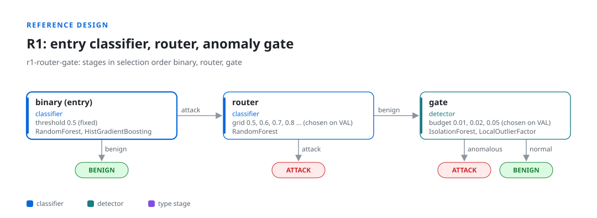

# Getting started

This page takes you from installation to a first report in about five minutes on a laptop.

## Install

[INSTALL.md](../INSTALL.md) walks through the install on [Windows](../INSTALL.md#windows),
[macOS](../INSTALL.md#macos) and [GNU/Linux](../INSTALL.md#gnulinux), from the download to the
dashboard. In short, inside a virtual environment:

```bash
pip install "git+https://github.com/hashtagRR/IDSLab.git"
```

## A first run

The commands below are written as `idslab ...`, which works when the virtual environment is active.
Without activating it, call the program by its path: `.venv/bin/idslab` on Linux and macOS,
`.\.venv\Scripts\idslab` in Windows PowerShell (the leading `.\` is required there). See
[Windows, step by step](../INSTALL.md#windows).

```bash
idslab example demo
```

This writes a synthetic flow dataset (`demo/data/train.parquet`, `demo/data/test.parquet`, with
types Normal, DoS, Scan, Exploit and Worms) and three reference configs:

| Config                  | Design                                                                     |
|-------------------------|----------------------------------------------------------------------------|
| `r1_router_gate.yaml`   | entry classifier, a router with a cutoff chosen on VAL, a benign-trained anomaly gate |
| `r2_anomaly_first.yaml` | anomaly detector first, then a classifier that can clear its alarms        |
| `r1_four_layer.yaml`    | entry, router, a type stage that uses the router's score, a gate refitted on each batch |



[Example designs](../examples/README.md) shows all three.

Check a config without reading any data:

```bash
idslab validate demo/r1_router_gate.yaml
```

```text
demo/r1_router_gate.yaml: valid
  stages in selection order: binary > router > gate
  binary: classifier, threshold [0.5] (fixed), candidates RandomForestClassifier#0, HistGradientBoostingClassifier#1
  router: classifier, grid [0.5, 0.6, 0.7, 0.8, 0.9] (chosen on VAL), candidates RandomForestClassifier#0
  gate: detector, budget [0.01, 0.02, 0.05] (chosen on VAL), candidates IsolationForest#0, LocalOutlierFactor#1
  controls compare against: binary; seeds [0, 1, 2]
```

Run it:

```bash
idslab run demo/r1_router_gate.yaml --out demo/runs
```

Each seed takes under a minute on the synthetic data. Progress goes to stderr (stage fitted,
configuration frozen on VAL, TEST evaluation); the result line per seed and the report path go to
stdout. Add `--jobs -1` to run the seeds in parallel on all cores.

## Reading the result

Open `demo/runs/r1-router-gate/report.html` in a browser (or `report.md` in any editor).


 The first
lines answer the main question: does the cascade beat its first stage alone?

- **cascade accuracy** and **first stage alone**: TEST objective, mean and standard deviation over
  seeds.
- **cascade minus first stage**: the difference, with paired bootstrap intervals per seed further
  down. A negative value means the extra stages cost accuracy on this data.
- **frontier gap**: whether the cascade reaches an operating point that moving the first stage's
  threshold cannot. Positive is evidence that the stages add something beyond a threshold change.

The cascade map shows how often selection kept each stage on, the values it chose, and how much the
objective drops when that stage is switched off. [Protocol and controls](protocol.md) explains every
number; [Outputs](outputs.md) lists every file.

## The same in the browser

```bash
idslab dashboard --workspace demo --open
```

The [dashboard](dashboard.md) lists the experiments in `demo` with the next step for each. It guides
a new design through data, cascade, evaluation and a run, follows the job, and shows the results
next to the full report.

## Your own data

1. Put your flows in Parquet or CSV: one row per flow, feature columns, and a binary label (0 benign,
   1 attack), an attack type column, or both.
2. Copy a reference config next to the data and change `dataset` (file paths are relative to the
   config file) and the categorical columns listed for `idslab.prep.Encode`.
3. `idslab validate`, then `idslab run`.

The [config reference](config-reference.md) lists every key. Large datasets: start with
`protocol.subsample: {train: 50000}` and one seed to check the design, then remove the subsample.
