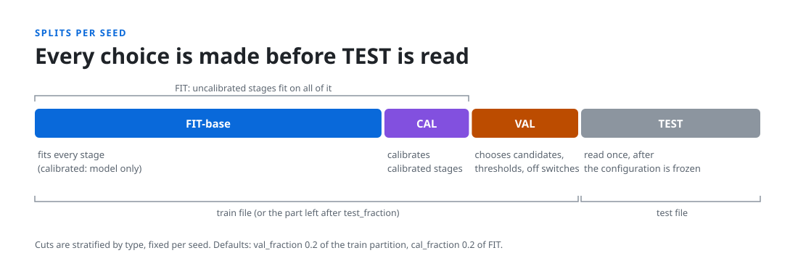
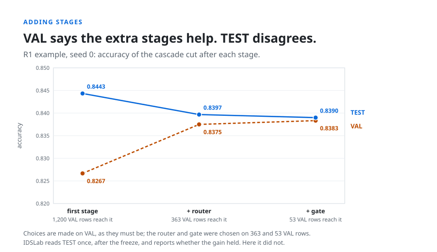
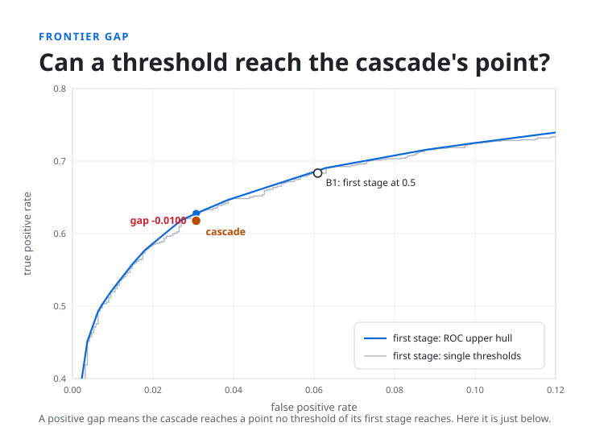

# How IDSLab works, in figures

This page walks through one run of a reference design and the figures that explain it. The figures
come from one seed of the design on the synthetic example data (`idslab example`); the dashboard
screenshot at the end shows all three seeds.

## Why a cascade needs a fixed protocol

A staged IDS splits detection into steps. A first classifier sees every flow; later stages (a second
classifier, an anomaly detector, a type classifier) re-check the flows it sends them, to catch attacks
it missed or clear its false alarms. Many published designs report a gain over a single model, and the
gain is easy to overstate:

- thresholds or stages are chosen while looking at the test set;
- the cascade is compared with a different single model, not with its own first stage tuned as
  carefully;
- the same gain could come from moving the first stage's threshold, no extra stage needed;
- nobody checks what each stage contributes, so a stage that does nothing stays in the design.

IDSLab rules these out for any design you can describe, with the same protocol every time, so two
designs (or two papers) compare on equal terms.

## What a run does

**1. You describe the design.** Stages, models, decisions and routes:

```yaml
name: r1-router-gate
dataset: {train: data/train.parquet, test: data/test.parquet, label: label, type: attack_cat}
entry: binary
stages:
  binary:                        # sees every flow
    kind: classifier
    pipeline: [{class: idslab.prep.Encode, params: {categorical: [proto, service]}}]
    candidates: [{class: sklearn.ensemble.RandomForestClassifier}]
    decision: {threshold: 0.5, off: benign}
    routes: {attack: router, benign: BENIGN}
  router:                        # keeps confident attacks, sends the rest to the gate
    kind: classifier
    pipeline: [{class: idslab.prep.Encode, params: {categorical: [proto, service]}}]
    candidates: [{class: sklearn.ensemble.RandomForestClassifier}]
    decision: {grid: [0.5, 0.6, 0.7, 0.8, 0.9], off: attack}
    routes: {attack: ATTACK, benign: gate}
  gate:                          # anomaly detector trained on benign flows only
    kind: detector
    fit_on: benign
    pipeline: [{class: idslab.prep.Encode, params: {categorical: [proto, service]}}]
    candidates: [{class: sklearn.ensemble.IsolationForest}]
    decision: {budget: [0.01, 0.02, 0.05], off: normal}
    routes: {anomalous: ATTACK, normal: BENIGN}
```


Any acyclic graph works: stages can re-check, clear alarms, name attack types, or feed their scores
to later stages. Any model can sit in a stage: scikit-learn, XGBoost, LightGBM, PyOD, PyTorch, your
own class, or scores from a model trained elsewhere. The [example designs](../examples/README.md)
show all three reference cascades.

**2. It splits the data per seed and locks TEST away.**



**3. It makes every choice on VAL**, one stage at a time: which candidate model, which threshold, and
whether the stage stays on at all. Switching a stage off is always an option, and ties go to off.

**4. It reads TEST once**, for the frozen cascade and for controls built from the same fitted first
stage, over several seeds. The [protocol page](protocol.md) gives every rule.

## What you learn

Every report answers three questions.

**Does the cascade beat its first stage alone?** Here VAL said the extra stages help; TEST says they
cost 0.005. The report gives the difference with paired bootstrap intervals and the spread over seeds.



**Could a threshold do the same?** The frontier gap compares the cascade's detection rate with the
best the first stage reaches at the same false alarm rate. The report gives it twice: the step value
compares with single thresholds, and the interpolated value with the upper hull of the ROC curve,
which also covers mixing two thresholds. A positive interpolated gap means the stages reach a point
that no threshold, and no mix of two, can reach; here the cascade sits just below the first stage's curve.



**What does each stage do?** Every flow's path is recorded. Here the router passes 73 attacks to the
gate, and the gate catches none of them; switching the gate off costs nothing, and the report's stage
table says so.


The same run also gives the configuration chosen in every seed, the full selection trace, recall on
attack families held out of training, and per-type results when the design names attack types. The
[outputs page](outputs.md) lists every file.

## The same run in the dashboard

`idslab dashboard` shows each experiment with its next step, a guided setup, the job's progress, and
a results page that reads the cascade against its first stage with the per-unit bootstrap. The
[dashboard guide](dashboard.md) covers every page.


