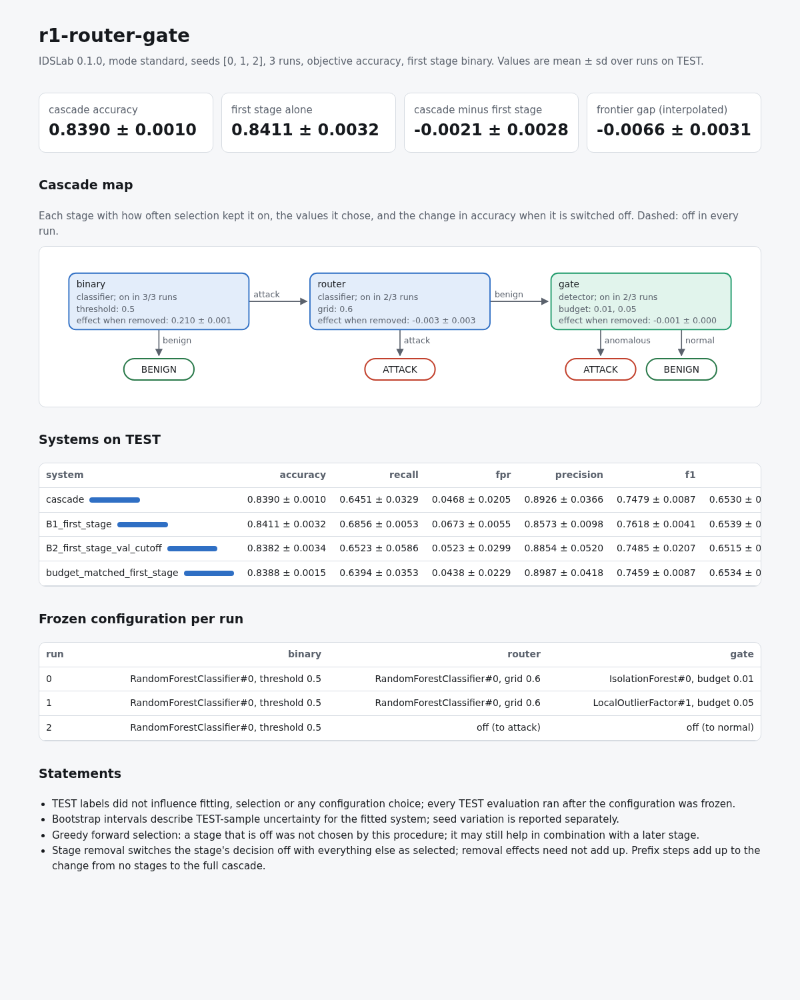
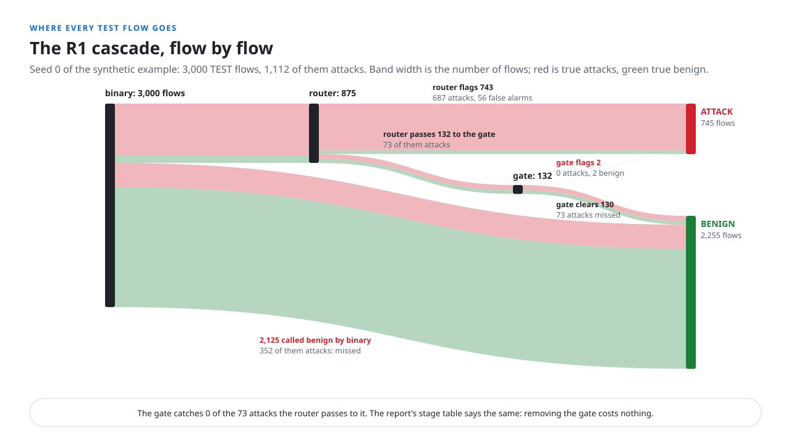

# Outputs

```text
runs/<name>/
  report.md            all seeds, Markdown
  report.json          the same aggregate, as data
  report.html          one self-contained page: headline figures, cascade map, tables
  <mode>/seed_<s>/     one run unit (held-out mode: <mode>/seed_<s>/fam_<family>/)
    summary.json
    per_flow.parquet
    val_flow.parquet
    split_ids.parquet
    DONE
```



`<mode>` is `standard`, `heldout_family` or `natural_novelty`. The report pages and `report.json` are
rewritten after every run (unless `--no-report`) and by `idslab report`.

## summary.json

| Key                    | Content                                                                 |
|------------------------|-------------------------------------------------------------------------|
| `idslab_version`, `config_name`, `config_fingerprint`, `mode`, `seed`, `family` | identity of the unit |
| `split_sizes`          | rows in FIT-base, CAL, VAL and TEST                                     |
| `split_log`            | merges of rare strata, subsamples, removed families                     |
| `data_notes`           | label and type disagreements, filled types                              |
| `candidates`           | per stage: every fitted candidate with class, training rows, calibration rows, search score, best parameters, fit time, and the producer block of external scores |
| `selection_trace`      | per stage in order: VAL rows reaching it, every option tried with its VAL objective, candidate AUCs, fallbacks, the choice |
| `frozen_configuration` | per stage: off, or candidate, decision mode, value and threshold        |
| `controls`             | systems on TEST, bootstrap intervals, frontier gap, budget-matched threshold, stage removal, prefix steps, prevalence, and in the other modes the unseen-attack block and type metrics |
| `stage_cost`           | per stage that is on: share of TEST flows reaching it, scoring time per 1,000 flows |
| `statements`           | the protocol statements printed in every report                         |
| `runtime_seconds`      | wall time of the unit                                                   |

## per_flow.parquet (TEST)



One row per TEST flow: `row_id`, `y` (true label), `type` (when the dataset has one), `score_<stage>`
for every active stage's chosen candidate, `path` (stages visited, joined by `>`), `exit_stage`,
`pred_<system>` for the cascade and every control (1 = attack), and `type_recorded` when a type stage
is active.

## val_flow.parquet

One row per VAL flow: `row_id`, `y`, and `score_<stage>__<candidate>` for every candidate of every
stage, so any selection choice can be recomputed.

## split_ids.parquet

`row_id` and `split` (FIT-base, CAL, VAL, TEST) for every row the unit used.

## DONE

```json
{"fingerprints": {"config": "...", "data": {"train": "...", "test": "..."}, "split": "...",
                  "package_version": "0.1.0", "family": null, "external": {}},
 "finished": "2026-10-16T09:37:40+00:00"}
```

Written last, so a unit without `DONE` did not finish. `external` maps every external score file and
its `.json` sidecar to its hash. See [Resume](protocol.md#resume).

## Splits export

`idslab export-splits CONFIG --out splits` writes `splits/<name>/splits_seed<s>.parquet` (held-out
mode: `splits_seed<s>_fam_<family>.parquet`) with `row_id`, `split` and `oof_fold` (the out-of-fold
fold of each FIT row, -1 for VAL and TEST), plus a `.json` sidecar holding the config name and hash,
the IDSLab version, mode, seed, family, split fingerprint and number of out-of-fold folds.
[Scores made elsewhere](models.md#scores-made-elsewhere) shows how a score file is built from it.
