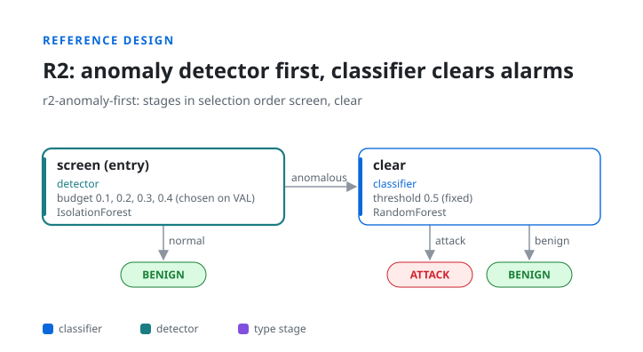
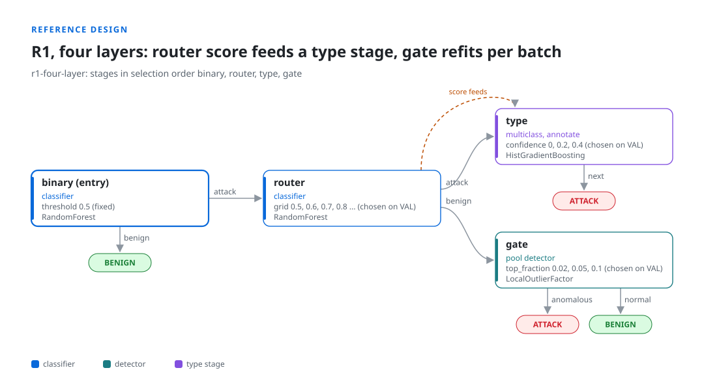

# Example designs

`idslab example DIR` writes a synthetic flow dataset and three reference designs to `DIR`. The
configs ship inside the package ([src/idslab/examples](../src/idslab/examples)); this folder adds two
scripts for the cases a config alone cannot cover.

```bash
idslab example demo
idslab run demo/r1_router_gate.yaml --out demo/runs
```

## The synthetic dataset

`demo/data/train.parquet` (6,000 flows) and `demo/data/test.parquet` (3,000 flows), with two
categorical columns (`proto`, `service`), six numeric features (`x0` to `x5`), a binary `label` and an
`attack_cat` type: Normal, DoS, Scan, Exploit and Worms. It is small enough that a seed runs in under a
minute; it shows how IDSLab works, and is not a benchmark.

## R1: entry classifier, router, anomaly gate


[`r1_router_gate.yaml`](../src/idslab/examples/r1_router_gate.yaml). The entry classifier sends what it
calls benign straight out. A second classifier, the router, keeps confident attacks and sends the rest
to a benign-trained detector, which can still flag them. The router's cutoff and the gate's false
alarm budget are chosen on VAL, each with "off" as an option.

On the synthetic data (3 seeds) the router and gate raise VAL accuracy, but the cascade ends at
0.8390 TEST accuracy against 0.8411 for the entry classifier alone, and selection switched both
later stages off in one seed. The report shows exactly this: it is the case the controls exist for.

## R2: anomaly detector first



[`r2_anomaly_first.yaml`](../src/idslab/examples/r2_anomaly_first.yaml). A detector screens every flow;
only its alarms reach a classifier, which can clear them. The design also shows a known limit of
greedy selection: the screen is chosen while the classifier after it is off. Run it with
`protocol.search: joint` to see the check find a better combination
([Known limitations](../docs/limitations.md)).

## R1, four layers



[`r1_four_layer.yaml`](../src/idslab/examples/r1_four_layer.yaml). The full form of R1: the router's
score is an extra feature of a type stage (out-of-fold on FIT), the type stage names the attack
without changing the verdict, and the gate is refitted on each batch of flows that reaches it.

## Your own model behind an adapter: `custom_adapter.py`

A model without the scikit-learn interface needs a small class that names its score contract.
`ZScoreRule` turns a hand-written rule into an attack probability:

```yaml
candidates:
  - class: custom_adapter.ZScoreRule
    params: {columns: [x0, x1, x2]}
```

```bash
PYTHONPATH=examples idslab run my_config.yaml
```

See [Models in stages](../docs/models.md#your-own-adapter-class) for the four contracts.

## A model trained elsewhere: `external_score_job.py`

The round trip for a model trained outside IDSLab, for example on a GPU machine:

```bash
idslab export-splits demo/r1_four_layer.yaml --out splits
python examples/external_score_job.py --splits splits/r1-four-layer/splits_seed0.parquet \
    --train demo/data/train.parquet --test demo/data/test.parquet --out scores/mlp_0.parquet --oof
```

```yaml
candidates: [{external: {path: scores/mlp_{seed}.parquet}, label: mlp}]
```

The script trains a small MLP on exactly the exported FIT rows, scores VAL and TEST, writes
out-of-fold scores for the FIT rows (`--oof`, needed when the stage's score feeds another stage), and
writes the sidecar IDSLab checks. Replace the model with your own and keep the rest. Rules:
[Scores made elsewhere](../docs/models.md#scores-made-elsewhere).

Both scripts run in the test suite (`tests/test_examples.py`), so they stay in step with the code.
